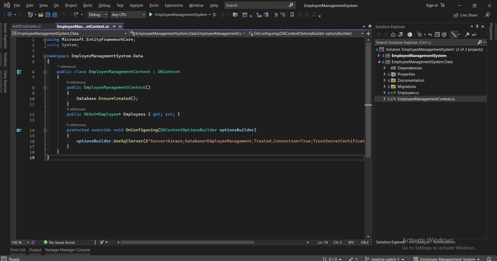

# How to Run Employee Management System

Follow the steps below to configure and run the application locally.

### Prerequisites

- [Visual Studio 2022](https://visualstudio.microsoft.com/) with **.NET Desktop Development** workload installed
- [Microsoft SQL Server](https://www.microsoft.com/sql-server/sql-server-downloads) or SQL Server LocalDB
- [.NET 7.0 SDK](https://dotnet.microsoft.com/en-us/download/dotnet/7.0)

---

### Step-by-Step Guide

1. **Clone the Repository**:
   ```bash
   git clone https://github.com/dawinder12/Employee-Management-System.git
   ```

2. **Open the Solution**:
   Double-click `EmployeeManagementSystem.sln` to open the project in Visual Studio.

3. **Configure the Connection String**:
   Open `EmployeeManagementSystem.Data/EmployeeManagementContext.cs` and update the connection string to point to your local SQL Server instance:
   ```csharp
   protected override void OnConfiguring(DbContextOptionsBuilder optionsBuilder)
   {
       optionsBuilder.UseSqlServer(@"Server=YOUR_SERVER_NAME;Database=EmployeeManagement;Trusted_Connection=True;TrustServerCertificate=True;");
   }
   ```

   

4. **Build the Solution**:
   In Visual Studio, go to the top menu and select **Build > Build Solution** (or press `Ctrl + Shift + B`).

5. **Run the Project**:
   Press `F5` or click the green **Start** button to run the application.

6. **Sample Data**:
   You can use the included [`employees.csv`](employees.csv) file to test the CSV import functionality from the Employee Details screen.