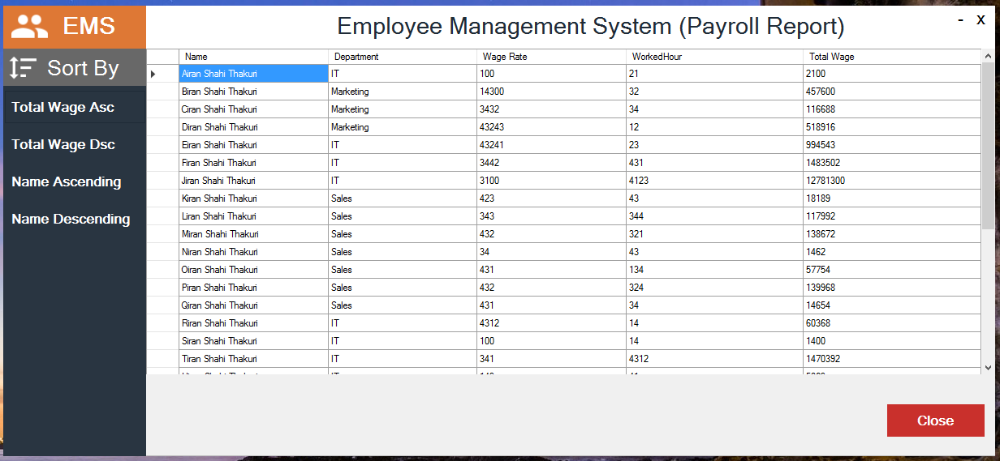
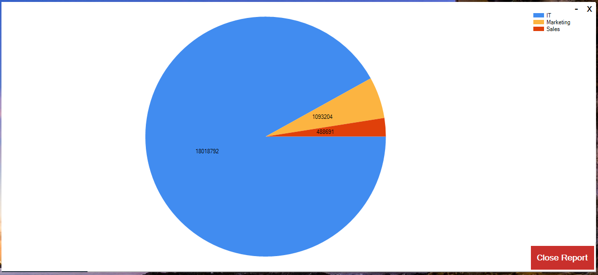

# Employee Management System

A desktop application built with **C#** and **.NET 7 Windows Forms** for managing employee records, tracking working hours, calculating payroll wages, importing/exporting data via CSV, and visualizing departmental expenses.

---

## Key Features

- **Employee Record Management**: Add, view, edit, and delete employee details.
- **CSV Data Import & Export**: Import employee details from CSV files (sample template provided in [`employees.csv`](employees.csv)) and export data directly to CSV.
- **Automated Payroll Calculation**: Calculate total wages accurately based on logged hours and hourly wage rates.
- **Reporting & Charts**: Generate visual pie-chart analytics showing total wages distributed across departments.
- **Database Persistence**: Entity Framework Core with SQL Server.

---

## Project Structure & Setup

Refer to the [How to Run Guide](HOW_TO_RUN.md) for full setup instructions.

### Quick Start:

1. **Clone the repository**:
   ```bash
   git clone https://github.com/dawinder12/Employee-Management-System.git
   ```
2. **Open the solution**:
   Open `EmployeeManagementSystem.sln` in [Visual Studio](https://visualstudio.microsoft.com/).
3. **Configure Database Connection**:
   Update your SQL Server connection string in `EmployeeManagementSystem.Data/EmployeeManagementContext.cs`:
   ```csharp
   optionsBuilder.UseSqlServer(@"Server=YOUR_SERVER;Database=EmployeeManagement;Trusted_Connection=True;TrustServerCertificate=True;");
   ```
4. **Build and Run**:
   Press `F5` to build and launch the application.

---

## Prerequisites & Dependencies

- [.NET 7.0 SDK / Runtime](https://dotnet.microsoft.com/en-us/download/dotnet/7.0)
- [Visual Studio 2022](https://visualstudio.microsoft.com/) (.NET desktop development workload)
- [Microsoft SQL Server](https://www.microsoft.com/sql-server/sql-server-downloads) or SQL Server LocalDB
- [Microsoft.EntityFrameworkCore (7.0.3)](https://learn.microsoft.com/en-us/ef/core/)
- [Maikebing.System.Windows.Forms.DataVisualization (5.0.1)](https://www.nuget.org/packages/Maikebing.System.Windows.Forms.DataVisualization/5.0.1)

---

## Screenshots

### Home Screen


### Import CSV


### Employee Details


### Add Employee Form


### Edit Employee Form


### Payroll Calculation


### Departmental Report Chart


